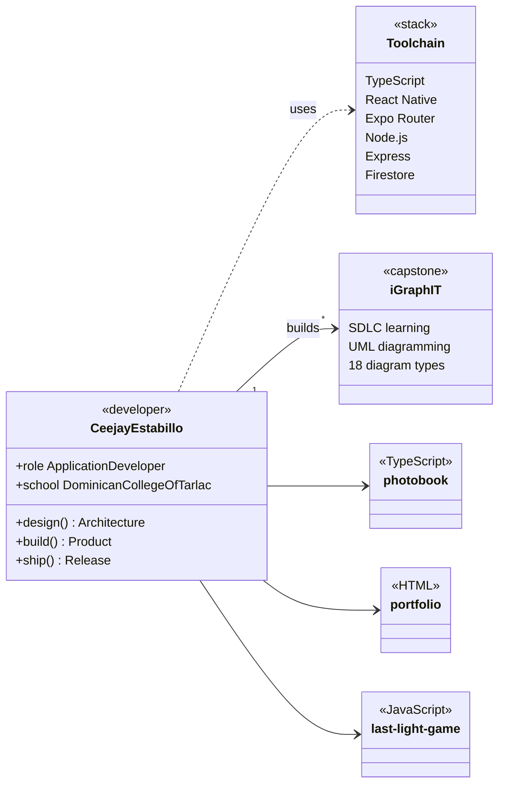
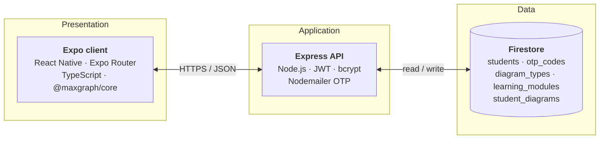

<h1 align="center">Ceejay Estabillo</h1>

<p align="center">
  Application developer · TypeScript end to end<br />
  <sub>BS Information Technology, Dominican College of Tarlac</sub>
</p>

<p align="center">
  <a href="#profile-as-a-class-diagram">Profile</a> &nbsp;·&nbsp;
  <a href="#featured-project">Featured project</a> &nbsp;·&nbsp;
  <a href="#repositories">Repositories</a> &nbsp;·&nbsp;
  <a href="#stack">Stack</a> &nbsp;·&nbsp;
  <a href="#status">Status</a>
</p>

---

I build mobile and web applications with a focus on clean architecture, predictable state, and interfaces that hold up across screen sizes. React Native and Expo on the client, Node.js and Express on the server, Firestore for persistence.

I am the programmer on a four-year capstone project, where I own the front end, the API, and the diagram-rendering layer.

## Profile as a class diagram

My capstone is a UML learning tool, so this is my profile in the notation it teaches.



## Featured project

### iGraphIT

A Progressive Web Application that teaches SDLC models and lets students build UML diagrams with rule-based validation, covering 18 diagram types from flowcharts and DFDs to class and sequence diagrams.



<details>
<summary><b>Engineering notes</b></summary>
<br />

| Area | What I built |
| :-- | :-- |
| **Diagram editor** | Custom `UniversalVertexHandler` on `@maxgraph/core`, giving draw.io-style selection and rotation handles through the library's native rotation pipeline |
| **Validation** | One shared structural rule engine behind 11 diagram-type validators, so every diagram is checked against its own notation rules |
| **Authentication** | Express API with JWT access and refresh tokens, bcrypt password hashing, and OTP email verification through Nodemailer |
| **Google sign-in** | Redirect flow on mobile, chosen by touch-capability detection rather than user-agent sniffing |
| **Performance** | Cache-first profile loading on the account screen |

</details>

[View repository →](https://github.com/ceejaydev1/igraph-it)

## Repositories

| Repository | Stack | Description |
| :-- | :-- | :-- |
| [igraph-it](https://github.com/ceejaydev1/igraph-it) | JavaScript | SDLC learning and UML diagramming PWA (capstone) |
| [photobook](https://github.com/ceejaydev1/photobook) | TypeScript | <!-- one-line description --> |
| [portfolio](https://github.com/ceejaydev1/portfolio) | HTML | Personal portfolio site |
| [last-light-game](https://github.com/ceejaydev1/last-light-game) | JavaScript | <!-- one-line description --> |

## Stack

| | |
| :-- | :-- |
| **Languages** | TypeScript · JavaScript · HTML · CSS |
| **Client** | React Native · Expo · Expo Router · React · PWA |
| **Server** | Node.js · Express |
| **Data** | Firebase · Firestore |
| **Tooling** | Git · GitHub · Metro |

## Status

```ts
const status = {
  building: "iGraphIT, capstone",
  learning: ["API design", "deployment pipelines"],
  open_to:  ["internships", "collaboration"],
} as const;
```
